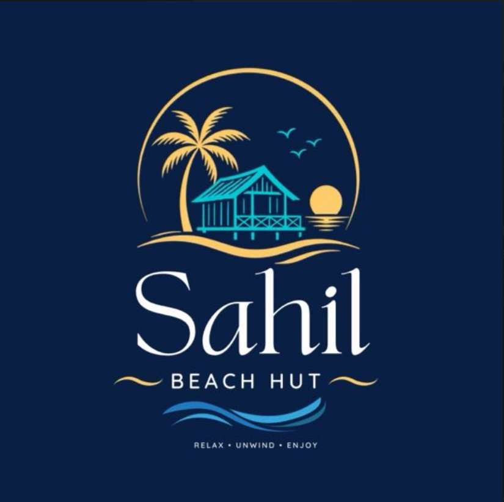

# 🌊 Sahil Beach Hut — Water Sports & Jet Ski Booking Web Application

A luxury, water-themed booking web application built for **Sahil Beach Hut**, Karachi's premier marine water sports and jet ski experience at **Hawksbay Beach**, **Turtle Beach**, and the **Mangrove Forest**.



---

## 🚀 Quick Start

### Option 1: Direct File Launch
Double click `index.html` or open it with Google Chrome, Edge, or any modern browser.

### Option 2: Run Local Server (Recommended)
Open PowerShell or Terminal in this folder:
```bash
python server.py
```
Then visit: [http://localhost:3000](http://localhost:3000)

---

## 💰 Official Jet Ski Pricing Packages

| Tier | Engine / Horsepower | 1 Hour Thrill Ride | Full Day Package | Included In Package |
| :--- | :--- | :--- | :--- | :--- |
| 🥉 **1. Standard Package** | **700 HP** Jet Ski | **Rs. 20,000** | **Rs. 80,000** | 100% Fuel, Life Jackets, Safety Briefing, Instructor Guide |
| 🥈 **2. Premium Package** ⭐ *(Most Popular)* | **1100 HP** Jet Ski | **Rs. 25,000** | **Rs. 100,000** | **Includes 1 Dedicated Lifeguard**, High-speed perimeter, Fuel |
| 👑 **3. VIP Luxury Package** | **1800 HP** Monster Ski | **Rs. 30,000** | **Rs. 120,000** | **Includes 2 Dedicated Lifeguards**, VIP priority launch, Maximum power |

*🎉 Sunday Special Packages available upon advance reservation!*

---

## 🔥 Featured Watercraft Spotlight

### **Yamaha VX 1400 Sport – 145 HP**
- ✔ Powerful 145 HP High-Output Marine Engine
- ✔ High-Speed Wave Carving Performance
- ✔ Premium & Comfortable Ergonomic Ride
- ✔ Capacity for Up to 2 Riders
- ✔ Professional Safety Standards & Lanyards
- ✔ Perfect for Families, Couples & Adventure Lovers

---

## ✅ Package Inclusions (All Rides)

1. ⛽ **Fuel Included** — 100% full tank ready with zero hidden surcharge.
2. 👨‍🏫 **Professional Instructor** — Hands-on coaching for novices and pros.
3. 🏊🏻‍♂️ **Experienced Lifeguards** — Active rescue swimmers monitoring the perimeter.
4. 🦺 **Life Jackets** — Sanitized, USCG-approved high buoyancy gear.
5. 📋 **Safety Briefing** — Kill-switch instructions, throttle control, wave etiquette.
6. 🏖️ **On-Site Support Team** — Ground marshals at Hawksbay & Turtle Beach.
7. 🚤 **Self-Drive Option (With Instructor)** — Take the controls safely.

---

## 📍 Available Locations in Karachi

- 🏖 **Hawksbay Beach Karachi** — Rolling Arabian Sea surf, golden sands, beach huts.
- 🏖 **Turtle Beach Karachi** — Clear turquoise lagoons, calm reef breaks, sunset vistas.
- 🌿 **Mangrove Forest Karachi** — Flat glassy eco-waterway cruising with zero swells.

---

## ⚠️ Important Guidelines

- **Advance Booking Recommended**: Especially for high-demand weekend tides.
- **Solo Rides Not Allowed**: In accordance with maritime coastal safety rules, every rider must be accompanied by a companion or a certified instructor.
- **Sunday Specials**: Reserve ahead to lock in weekend time slots.
- **Custom Locations**: Trailer dispatch available with prior notice.

---

## 📞 Contact Information

- **WhatsApp / Phone**: [+92 309 1331516](https://wa.me/923091331516)
- **Email**: [sahilbeachhut@gmail.com](mailto:sahilbeachhut@gmail.com)
- **Website**: [www.sahilbeachuts.com](http://www.sahilbeachuts.com)
- **Base**: Hawksbay & Turtle Beach, Karachi, Sindh, Pakistan

*🌊 Ride the Waves. Feel the Power. Live the Adventure. 🚤*
